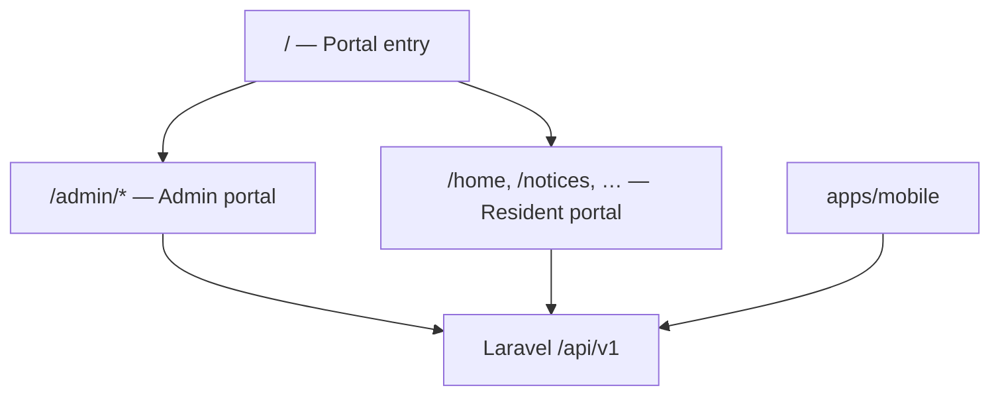

# Monorepo Structure

`Nbr-link/` is organized into **four top-level areas**: `apps`, `frontend`, `backend`, and `docs`.

## Layout

```text
Nbr-link/
├── apps/                       # Client applications (native / mobile)
│   └── mobile/                 # React Native (Expo SDK 56) — residents' primary client
│       ├── app/                # expo-router routes
│       ├── components/
│       ├── constants/
│       ├── assets/
│       └── package.json
│
├── frontend/                   # Web portal — ONE Next.js codebase
│   ├── src/
│   │   ├── app/
│   │   │   ├── page.tsx        # Portal entry (pick admin vs resident)
│   │   │   ├── (admin)/        # Admin operator experience → /admin/*
│   │   │   └── (portal)/       # Resident experience → /home, /notices, …
│   │   ├── components/
│   │   │   ├── admin/
│   │   │   └── portal/
│   │   └── lib/                # api client, auth, shared utils
│   └── package.json
│
├── backend/                    # Laravel 11 API (PHP 8.2+, MySQL 8)
│   ├── app/
│   ├── routes/
│   ├── database/
│   └── composer.json
│
├── docs/                       # Source of truth for product & engineering
└── package.json                # Root orchestrator scripts
```

## Why this layout

| Folder | Purpose |
|--------|---------|
| **apps/** | Deployable **client apps** that are not the web portal (today: mobile only). Keeps native/mobile isolated from web. |
| **frontend/** | **One** web codebase for admin + resident portals. Shared design tokens, API client, and auth — no duplicate Next.js projects. |
| **backend/** | Single REST API consumed by mobile and frontend. |
| **docs/** | Specifications, OpenAPI, ERD, and feature specs. |

## Tooling

| Concern | Choice |
|---------|--------|
| Mobile deps | `npm install` in `apps/mobile/` → `apps/mobile/node_modules` (Expo/Metro safe) |
| Frontend deps | `npm install` in `frontend/` → `frontend/node_modules` |
| Backend deps | `composer install` in `backend/` → `backend/vendor/` |
| Root `package.json` | Script runner only (`npm run mobile`, `npm run frontend`, …) — **no workspaces, no root `node_modules`** |
| One-shot install | `npm run install:all` from repo root |

> The mobile app must follow Expo SDK 56 docs per repo `AGENTS.md`.

## Frontend routing (single portal)



Admin and resident UIs live in **route groups** `(admin)` and `(portal)` so layouts, sidebars, and permissions stay separate without maintaining two repositories.
