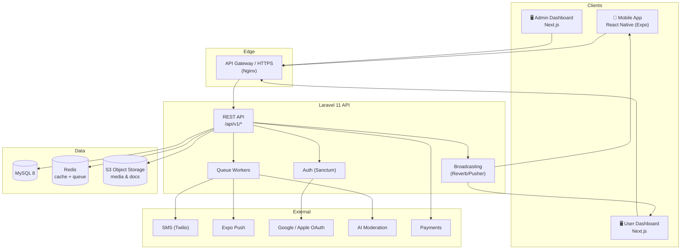

# System Architecture

## High‑level diagram

## Request lifecycle (typical mobile call)

1. Client attaches `Authorization: Bearer <sanctum-token>` and `Accept: application/json`.
2. Nginx terminates TLS → forwards to Laravel.
3. Sanctum resolves the user; middleware enforces the **active community scope** and role.
4. Controller → FormRequest validation → Service/Action → Eloquent → MySQL.
5. Side effects (push, SMS, moderation) are dispatched to **queued jobs**, not done inline.
6. Response is a consistent JSON envelope (see [API conventions](../05-api/api-conventions.md)).

## Multi‑tenancy by community

Almost every resource (notices, posts, amenities, deals, points) is **scoped to a `community_id`**. A user may belong to multiple communities via `community_memberships`; the client sends the **active community** and the backend authorizes membership + role for that community on every request.

## Realtime channels

- `community.{id}.feed` — new posts / comments.
- `community.{id}.notices` — new announcements/alerts.
- `user.{id}.notifications` — personal notifications, points, badges.

## Asynchronous work (queues)

| Job | Trigger |
|-----|---------|
| `SendOtpSms` | Phone signup / login |
| `SendPushNotification` | New notice, comment, reservation status, redemption |
| `RunContentModeration` | New post/comment/review created |
| `AwardPointsAndBadges` | Engagement events (post, comment, attend event, redeem) |
| `RecomputeLeaderboard` | Periodic + on points change |

## Security boundaries

- TLS everywhere; HSTS on web.
- Sanctum tokens; short‑lived where possible; device‑bound refresh on mobile.
- Role/permission checks per community (see feature permission matrices).
- Rate limiting on auth and write endpoints.
- Signed URLs for private media; no public bucket listing.
- Moderation gate before content becomes publicly visible (configurable per community).
