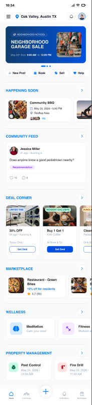

# Design Tokens

> Tokens are derived from the Figma file **Havena‑App** and the implemented mobile app (`constants/theme.js`, tab bar, and component styles). The mobile UI must match Figma exactly; dashboards reuse the same tokens via Tailwind theme config.



*Figma frame: "Final and Approved Homescreen" — the canonical home layout the app implements.*

## Brand colors

| Token | Value | Usage |
|-------|-------|-------|
| `brand/primary` | `#007BFF` (`rgba(190,219,255,1)`) | Primary accent, active tab icons, links |
| `brand/primary-deep` | `#0052DF` (`rgba(0,82,223,1)`) | Floating create button, gradient end |
| `brand/gradient` | `#007BFF → #0052DF` | CTAs, hero widgets, premium cards |

## Neutrals & text

| Token | Value | Usage |
|-------|-------|-------|
| `text/primary` | `#11181C` | Headings, primary body (light mode) |
| `text/secondary` | `#4A5565` (`rgba(74,85,101,1)`) | Active tab label, secondary text |
| `text/muted` | `#99A1AF` (`rgba(153,161,175,1)`) | Inactive tab icons, captions |
| `icon/default` | `#687076` | Default icons |
| `surface/background` | `#FFFFFF` | App / card background |
| `border/subtle` | `rgba(0,0,0,0.05)` | Card and tab‑bar borders |

### Dark mode (from `constants/theme.js`)

| Token | Value |
|-------|-------|
| `text` | `#ECEDEE` |
| `background` | `#151718` |
| `tint` | `#FFFFFF` |
| `icon` | `#9BA1A6` |

## Typography

| Role | Direction |
|------|-----------|
| Display / headline | Bold, large, tight line‑height (warm, confident) |
| Section label | Uppercase, tracked (e.g. "HAPPENING SOON", "COMMUNITY FEED", "DEAL CORNER") |
| Body | Clean, highly readable |
| Caption / meta | Muted, smaller |

Platform font families are resolved in `constants/font.js`. Shared colors and gradients live in `constants/tokens.js`. Dashboards mirror with a comparable sans stack.

## Spacing & layout

| Token | Value | Notes |
|-------|-------|-------|
| Screen gutter | `24–25px` | Matches Figma `x=24/25` content insets |
| Card radius | `12–16px` | Layered cards |
| Pill radius | `full` | Filter chips, tags |
| Mobile frame width | `390px` | All Figma frames are 390 wide (iPhone) |

## Elevation (shadows)

Cards and the floating create button use soft shadows:
```
shadowColor:#000, shadowOpacity:0.05–0.1, shadowRadius:8–10, offset:{0, ±2..4}, elevation:6–10
```

## Bottom tab bar

5 slots (from `app/(tabs)/_layout.jsx`): **Feed (Home) · Notices · Create (center FAB) · Wellness · Marketplace**.
- Active icon/label: `#007BFF` / `#4A5565`.
- Inactive: `#99A1AF`.
- Center "Create" is a raised circular button (`#0052DF`) that opens the Create modal.

## Component primitives (mobile, already implemented)

| Component | File |
|-----------|------|
| Top bar | `components/ui/top-bar.jsx` |
| Side menu | `components/ui/side-menu.jsx` |
| Search input | `components/ui/search-input.jsx` |
| OTP input | `components/ui/otp-input.jsx` |
| Back button | `components/ui/back-button.jsx` |
| Create modal | `components/ui/CreateNewModal.jsx` |
| Notice drawer | `components/ui/noticeDrawer.jsx` |
| Biometric dialogs | `components/biometric/faceid-dialog.jsx`, `fingerprint-dialog.jsx` |

> When building dashboards, replicate these tokens in `tailwind.config` so web and mobile feel like one product.
