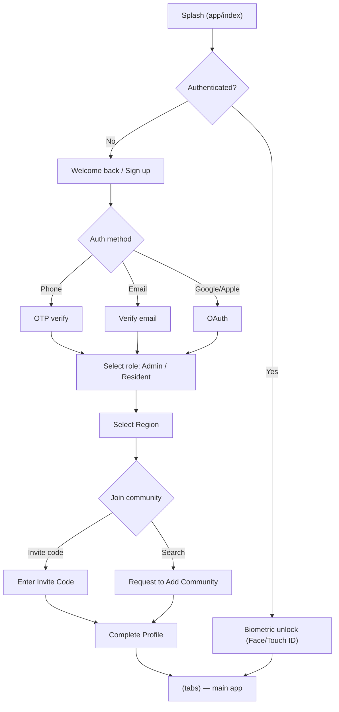
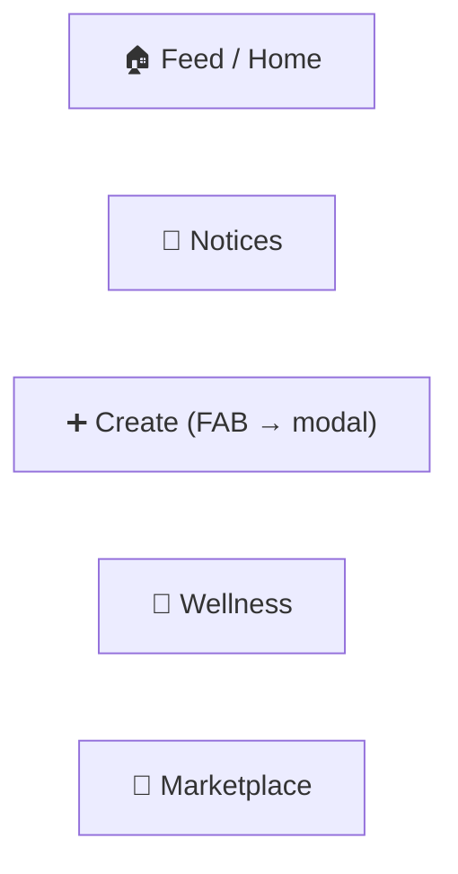
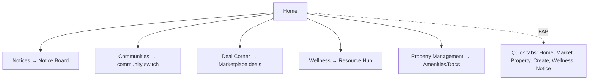

# Navigation Map (Mobile)

The mobile app uses **expo-router** file‑based routing. Auth/onboarding screens live under `app/screens/*`; the main app lives in the `(tabs)` group.

## Top‑level flow

## Tab bar

The center **Create** button opens `CreateNewModal` rather than navigating, offering: New Post, Notice, Event, Alert (role‑gated).

## Home widget stack → destinations

From `app/(tabs)/home.jsx`, the home scroll stacks widgets, each linking to its feature:

## Stack routes (registered in `app/_layout.jsx`)

Auth/onboarding: `roles`, `invite-code`, `request-for-community`, `region`, `signup`, `verifyregistration`, `find-community`, `complete-profile`, `login`, `login/verify-phone`.

Content: `create-notice`, `create-event`, `create-alert`, `create-post`, `event-detail`, `notification`.

Profile/gamification: `profile`, `profile/points-history`, `achievements`, `leaderboard`, `settings`.

Marketplace: `marketplace-listings` (+ `(tabs)/marketplace/*`).

Property: `property-management`, `property-management/amenity[/all-facilities[/reservation-calender[/rule-details]]]`, `property-management/community-rules`, `property-management/documents`, `property-management/my-booking`.

## Role‑aware UI

Role is held in `constants/role-session.js` (`resident` | `admin`) and passed through navigation params (`role`). Admin‑only actions (create announcement, create alert, manage marketplace, approve members) are gated on `admin`/`moderator`. See each feature's permission matrix in [03-features](../03-features/).
