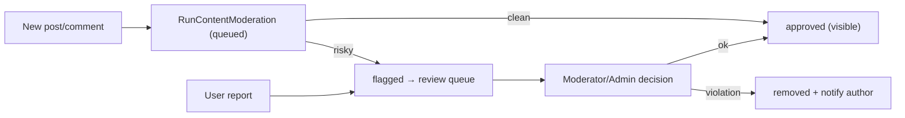

# Feature 5 — Community Feed

**Interactive Value · Priority P0 · Platforms: iOS, Android, Admin Dashboard · Dependencies: Auth, Community Membership, Moderation**

## Purpose

A **moderated social feed** where residents share, discuss, and connect — kept positive via AI‑assisted moderation and human review.

## User stories

Create a post (text + images); view feed; like/react; comment; reply to comments; share; follow a topic; search topics/results; report a post/comment; edit/delete own post; (moderator/admin) hide/remove content, warn/ban authors; receive realtime updates.

## Data model

```text
Post
├── id / community_id / author_id
├── body: text
├── media: json (image URLs)
├── topic: string (nullable)
├── like_count / comment_count: int (denormalized)
├── moderation_status: enum(pending, approved, flagged, removed)
└── timestamps

Comment
├── id / post_id / author_id / parent_id (nullable)
├── body: text
├── moderation_status
└── timestamps

Reaction
├── id / post_id / user_id / type: enum(like, ...)

Report
├── id / reportable_type / reportable_id / reporter_id
├── reason: enum(spam, harassment, discrimination, political, religious, other)
├── status: enum(open, reviewing, actioned, dismissed)
└── timestamps
```

## API endpoints

| Method | Endpoint | Description |
|--------|----------|-------------|
| GET | `/api/v1/communities/{cid}/feed` | Feed (paginated, `?topic=`) |
| POST | `/api/v1/communities/{cid}/posts` | Create post |
| GET | `/api/v1/posts/{id}` | Post detail |
| PUT/DELETE | `/api/v1/posts/{id}` | Edit/delete own (or moderator) |
| POST | `/api/v1/posts/{id}/react` | React/unreact |
| GET | `/api/v1/posts/{id}/comments` | List comments |
| POST | `/api/v1/posts/{id}/comments` | Add comment |
| POST | `/api/v1/{type}/{id}/report` | Report post/comment |
| POST | `/api/v1/moderation/{type}/{id}/action` | Hide/remove/restore (mod/admin) |

## Moderation pipeline



Auto‑flagged categories: political, religious conflict, discrimination, spam, harassment, personal attacks.

## Permission matrix

| Action | Resident | Moderator | Admin |
|--------|:--------:|:---------:|:-----:|
| Create post/comment | ✓ | ✓ | ✓ |
| React | ✓ | ✓ | ✓ |
| Edit/delete own | ✓ | ✓ | ✓ |
| Hide/remove others' content | ✗ | ✓ | ✓ |
| Ban author | ✗ | ✗ | ✓ |

## Screens

Community Feed (home widget + full feed), Comments, Search Topics, Search Results, Create Post.

## Acceptance criteria

- Content flagged by AI is withheld from public feed until reviewed (configurable per community).
- Realtime: new approved posts/comments push to `community.{id}.feed`.
- Reporting is one‑tap and creates a `Report` in the review queue.
