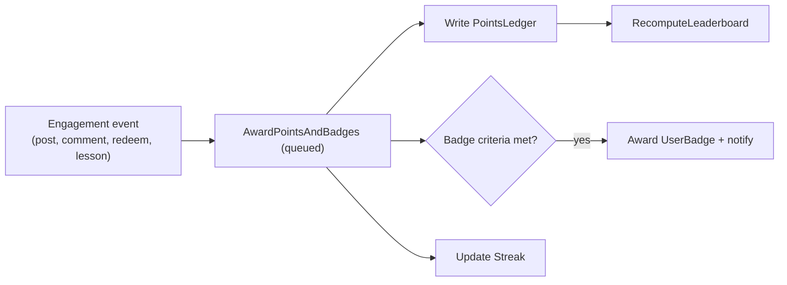

# Feature 7 — Gamification

**Interactive + Convenience Value · Priority P1 · Platforms: iOS, Android, Admin Dashboard · Dependencies: most features (emits engagement events)**

## Purpose

Make the neighborhood feel **active and rewarding** through points, badges, rankings, and streaks — driving daily return visits.

## Mechanics

- **Points** earned from engagement events (posting, commenting, RSVPing, attending events, completing wellness lessons, redeeming deals).
- **Badges** unlocked by reaching thresholds or completing specific actions.
- **Streaks** for consecutive days of activity.
- **Leaderboard** ranking members within a community.
- **Reputation** indicators shown on profile and feed.

## Earning rules (configurable per community)

| Event | Points (default) |
|-------|-----------------|
| Create a post | 10 |
| Comment | 3 |
| Receive a like | 1 |
| RSVP + attend event | 15 |
| Complete a wellness lesson | 8 |
| Redeem a deal | 5 |
| Daily login (streak) | 2 |

> Rules live in config/DB so admins can tune them without a release.

## Data model

```text
PointsLedger
├── id / user_id / community_id
├── event_type: string
├── points: int (can be negative for reversals)
├── source_type / source_id (polymorphic)
└── created_at

Badge
├── id / key / title / description / icon_url
└── criteria: json

UserBadge
├── id / user_id / badge_id / awarded_at

Streak
├── id / user_id / community_id
├── current_count / longest_count
└── last_active_on: date

LeaderboardSnapshot (optional cache)
├── id / community_id / period (weekly|monthly|all)
├── user_id / points / rank
└── generated_at
```

## API endpoints

| Method | Endpoint | Description |
|--------|----------|-------------|
| GET | `/api/v1/me/points` | My points balance + streak |
| GET | `/api/v1/me/points/history` | Points ledger (paginated) |
| GET | `/api/v1/me/badges` | My badges |
| GET | `/api/v1/communities/{cid}/leaderboard` | Leaderboard (`?period=weekly`) |
| GET | `/api/v1/achievements` | All badges + locked/unlocked state |

## Event flow



## Permission matrix

| Action | Resident | Moderator | Admin |
|--------|:--------:|:---------:|:-----:|
| Earn points / badges / view own | ✓ | ✓ | ✓ |
| View leaderboard | ✓ | ✓ | ✓ |
| Configure earning rules / badges | ✗ | ✗ | ✓ |

## Screens

Achievements (badges grid), Leaderboard, Points history, Profile + stats (`components/profile/profilestats.jsx`, `recentAchievements.jsx`).

## Acceptance criteria

- Points are awarded exactly once per qualifying event (idempotent via `source_type`+`source_id`).
- Reversing an action (e.g. deleting a post) reverses its points.
- Leaderboard supports weekly/monthly/all‑time and is community‑scoped.
