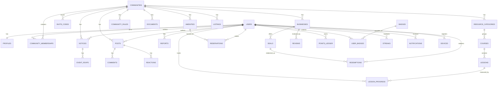

# Entity Relationship Diagram

All content entities are scoped to a **Community**. A User joins one or more Communities via **CommunityMembership** (which carries the role).

## Conventions

- Surrogate PK `id` (`BIGINT UNSIGNED AUTO_INCREMENT`). A public `uuid`/`ulid` column is exposed in API responses where opacity is desired.
- Timestamps `created_at` / `updated_at` on every table; `deleted_at` where soft deletes apply (users, posts, listings).
- Foreign keys are indexed; `community_id` is indexed on every scoped table.
- Enums use MySQL `ENUM` or a string column with an app‑level cast (Laravel enum casts).
- Money stored as `DECIMAL(10,2)`; never floats.

## Tenancy & integrity rules

- A user must have an `approved` `CommunityMembership` to read/write community content.
- Deleting a community cascades (soft) to its content; users persist (they may belong to other communities).
- Polymorphic `reports` and `points_ledger.source` reference content via `*_type` + `*_id`.
